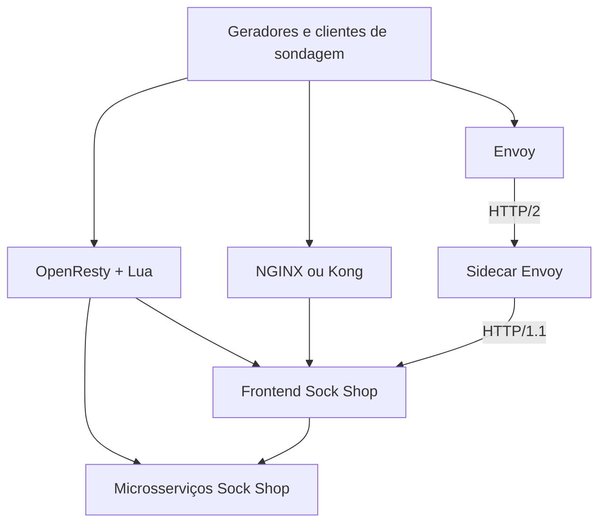

> [Índice de estudos](../README.md). Documento reorganizado em 20/10/2026; datas e resultados abaixo preservam o registro original. Caminhos em comandos continuam relativos ao diretório indicado no texto, não a esta pasta.

> Material de referência histórica. Para a arquitetura e as limitações conhecidas, comece pelo [mapa da aplicação](../study/APPLICATION_MAP.md). Afirmações antigas de equivalência, bypass ou saturação não substituem a medição experimental.

# Estado atual da aplicação e do laboratório do TCC

**Data do levantamento:** 6 de outubro de 2026.

**Escopo:** fotografia documental anterior às próximas alterações de implementação.

**Método:** inspeção dos arquivos locais e recálculo dos resultados CSV/JSON existentes.

## 1. Situação geral e limites deste registro

O projeto contém um laboratório de geração de carga sobre o Sock Shop, políticas de rate limiting e ferramentas de coleta. Há resultados históricos de testes básicos de Kong e NGINX e de cargas HTTP/2. A medição validada de precisão sob multiplexação HTTP/2 ainda não está concluída.

Neste documento:

- **Implementado** significa que o recurso está presente no código ou na configuração.
- **Evidência histórica** significa que existe um arquivo de resultado salvo, sem nova execução neste levantamento.
- **Pendente** significa que falta implementação, validação ou evidência suficiente.

Não foram iniciados ou encerrados containers, executadas cargas, reinstaladas dependências ou reexecutados testes. A consulta de leitura `docker ps` falhou por falta de permissão no socket `/var/run/docker.sock`. Portanto, o estado operacional dos serviços, as imagens efetivamente em execução e a saúde atual do backend não foram verificados.

O diretório não foi reconhecido como repositório pelo comando `git status`; não há um commit verificável associado a esta fotografia. Este documento não constitui backup dos arquivos ou dos volumes Docker.

## 2. Objetivo do TCC e relação com o laboratório

O objetivo registrado no [roteiro para o orientador](../presentations/ADVISOR_PRESENTATION_OUTLINE.md) é avaliar a precisão do rate limiting em **Kong, NGINX e Envoy sob multiplexação HTTP/2**, considerando:

- **Spillover:** admissões acima do permitido pela política de referência.
- **Falsos positivos:** bloqueios de requisições que a política deveria admitir.

Os algoritmos inspirados no artigo de Sivakumar e Thilagam apoiam a geração de carga. A aplicação alvo é o Sock Shop, uma demonstração de comércio eletrônico com microsserviços. Ausência de bypass também pode constituir resultado da pesquisa.

As fórmulas, os denominadores e a referência de admissão por algoritmo ainda precisam ser formalizados. As próximas modificações descritas no roteiro são propostas; não foi identificado, nos registros consultados, um documento posterior de aprovação pelo orientador.

## 3. Arquitetura implementada

Existem duas formas independentes de composição do laboratório. Ambas publicam as portas **8080 e 8443** e reutilizam nomes como `sockshop-gateway`; devem ser tratadas como alternativas de execução.

| Aspecto | Laboratório inspirado no artigo | Comparação de gateways |
|---|---|---|
| Entrada | `lab/setup/docker-compose.yml` | `lab/start.sh` |
| Composição | Compose próprio + build do gateway | Compose base + override selecionado |
| Gateway | OpenResty com Lua | NGINX, Kong ou Envoy |
| HTTP / TLS | 8080 / 8443 | 8080 / 8443 no host |
| Sonda do gateway | `/health` | `/healthz` |
| Encaminhamento | Rotas específicas diretamente aos microsserviços; fallback ao frontend | NGINX/Kong ao frontend; Envoy via sidecar |
| Finalidade | Reprodução/adaptação do laboratório do artigo | Comparação prevista para o TCC |

O diagrama apresenta alternativas, não gateways executados simultaneamente. Geradores e monitores são executados separadamente dos serviços Compose.

A [stack base](../../gateways/base/docker-compose.yml) contém frontend, catálogo, usuários, carrinho, pedidos, pagamento, entrega, queue-master, bancos e RabbitMQ, conectados à rede `sockshop-net`. Não há limites explícitos de CPU e memória de containers nos manifests inspecionados; alguns serviços Java configuram limites de heap em `JAVA_OPTS`.

As sondas respondem no gateway e não comprovam, isoladamente, que todos os serviços de negócio estejam saudáveis.

## 4. Políticas de rate limiting presentes

| Variante | Configuração inspecionada | Identidade / escopo | Observação |
|---|---|---|---|
| OpenResty/Lua | Janela fixa de 60 s; chave `AX001*`: 100/min, `BX001*`: 70/min, demais: 50/min; IP e usuário: 100/min | Chave completa; primeiro valor de `X-Forwarded-For` ou endereço remoto; `X-User-Id` | Avaliação na ordem chave → IP → usuário; interrupção na primeira rejeição |
| NGINX | `rate=100r/m`, `burst=100`, `nodelay`, status de rejeição 429 | `$binary_remote_addr` | Leaky bucket com tolerância de rajada; não equivale a uma cota estrita de 100 por janela fixa |
| Kong | Plugin `rate-limiting`, `minute: 100`, `policy: local`, `limit_by: ip` | IP determinado pelo Kong | A política efetiva declarada é local; não há seleção de janela deslizante no arquivo |
| Envoy | Filtro `local_ratelimit`, `max_tokens: 100`, `tokens_per_fill: 100`, `fill_interval: 60s` | Bucket local; não há descritores por IP na configuração | Há configurações separadas nos listeners HTTP e HTTPS; equivalência entre listeners e clientes não foi validada |

Fontes: [Lua](../../original_experiment/setup/gateway/ratelimit.lua), [NGINX](../../gateways/nginx/nginx.conf), [Kong](../../gateways/kong/kong.yml) e [Envoy](../../gateways/envoy/envoy.yaml).

Detalhes relevantes para a interpretação:

- No Lua, o prefixo determina a cota, mas o contador usa a chave completa. A dimensão usuário é ignorada quando o cabeçalho está vazio. `/health` e `/v3/api-docs` são isentos. Falhas na obtenção/incremento do contador liberam a passagem naquela dimensão.
- O Lua usa diretamente `X-Forwarded-For`, enquanto o NGINX limita pelo endereço remoto. Rotacionar esse cabeçalho não representa a mesma alteração de identidade em todas as variantes.
- O NGINX devolve `Retry-After: 60` na resposta de bloqueio. No Kong, um `response-transformer` global configura esse cabeçalho; sua presença, sozinha, não identifica rejeição.
- O script `start.sh` aceita `REDIS_URL`, exporta variáveis e habilita um serviço Redis opcional. Entretanto, `kong.yml` mantém `policy: local` e não referencia essas variáveis. Não há mecanismo de substituição desse arquivo no fluxo inspecionado. Assim, suporte efetivo a rate limiting com Redis não está demonstrado pela implementação atual.
- O Envoy tem rota direta `/healthz`, mas não há isenção explícita dessa rota no filtro de rate limiting. Seu comportamento sob esgotamento requer validação.

## 5. Versões declaradas e dependências

Estas são versões nos arquivos, não versões confirmadas de processos em execução.

| Componente | Versão declarada |
|---|---|
| OpenResty | `1.25.3.1-0-alpine` |
| NGINX | `1.27.0-alpine` |
| Kong | `3.7.1` |
| Envoy e sidecar | `v1.30.3` |
| Redis opcional do gateway | `7.2.5-alpine` |
| Sock Shop frontend / catálogo / banco do catálogo | `0.3.12` / `0.3.5` / `0.3.0` |
| Sock Shop usuários / banco de usuários | `0.4.7` / `0.4.0` |
| Sock Shop carrinho / pedidos | `0.4.8` / `0.4.7` |
| Sock Shop pagamento / entrega / queue-master | `0.4.3` / `0.4.8` / `0.3.1` |
| MongoDB de carrinho e pedidos / RabbitMQ | `3.4` / `3.6.8-management` |
| Go, diretiva do módulo | `1.21` |
| `golang.org/x/net` / `golang.org/x/text` | `v0.27.0` / `v0.16.0` |
| Python: HTTPX / pytest | `0.27.2` / `8.3.3` |

As demais dependências Python estão fixadas em [requirements.txt](../../requirements.txt), e as dependências Go em [go.mod](../../original_experiment/attacks/go.mod) e [go.sum](../../original_experiment/attacks/go.sum). As imagens são referenciadas por tags; os manifests não fixam seus digests. Certificado e chave TLS do laboratório estão disponíveis em `lab/gateways/tls/`; o build OpenResty gera seu próprio certificado. Nenhum conteúdo de chave foi reproduzido neste documento.

## 6. Descoberta, geração de carga e orquestração

| Componente | Comportamento implementado | Limite da evidência |
|---|---|---|
| [Algoritmo 1](../../original_experiment/algorithms/algorithm1_discover.py) | Descobre endpoints por OpenAPI, HTML/JS e dicas manuais opcionais | Descoberta não garante que a rota seja válida ou saudável |
| [Algoritmo 2](../../original_experiment/algorithms/algorithm2_identify.py) | Sonda latência e status; seleciona por latência e erros; salva JSON | Seleção heurística, sem medição direta do custo computacional |
| [Algoritmo 3](../../original_experiment/attacks/algorithm3_symmetric.py) | Carga simétrica HTTP/1.1 com processos paralelos | Chamadas sequenciais dentro de cada processo |
| [Algoritmo 4](../../original_experiment/attacks/algorithm4_asymmetric.py) | Carga HTTP/1.1 variando endpoints e parâmetros | Não constitui, por si só, controle experimental equivalente ao gerador HTTP/2 |
| [Algoritmo 5 original](../../original_experiment/attacks/algorithm5_http2_mux.go) | Geração concorrente HTTP/2 em Go | Ainda selecionado pelos lançadores |
| [Algoritmo 5 corrigido](../../original_experiment/attacks/algorithm5_http2_mux_fixed.go) | Cliente por worker, aleatoriedade por requisição, validação de flags, cancelamento e `StrictMaxConcurrentStreams` | Existe como entrada independente; conexões e streams reais não são registrados |

Também existem variantes shell dos algoritmos 3 e 4. Os geradores alternam cabeçalhos de identidade; no gerador HTTP/2 corrigido são enviados `X-API-KEY`, `X-Forwarded-For` e `X-User-Id` aleatórios. Não há opção de identidade fixa nesse gerador.

O parâmetro `streams` limita operações em andamento por worker. Seu valor não comprova o número de streams simultâneos na rede. A versão corrigida configura o transporte para respeitar o limite de streams do servidor, mas não mede o número de conexões efetivamente utilizado durante a rodada.

Tanto [attack_cli.py](../../original_experiment/attack_cli.py) quanto [run_lab.sh](../../original_experiment/run_lab.sh) chamam a versão **original** do Algoritmo 5. O `run_lab.sh` verifica `/health`, executa a descoberta/seleção e os geradores, e tenta monitorar `sockshop-gateway`. Várias etapas de carga usam `|| true`; chegar à mensagem final do script não comprova sucesso de todas elas.

## 7. Observabilidade disponível

- [monitor.sh](../../original_experiment/monitoring/monitor.sh): coleta CPU, memória, rede, disco e número de PIDs de um container em CSV. O intervalo padrão inclui uma pausa de 1 s, além do tempo da coleta. Há modo alternativo por PID.
- [monitor_client.py](../../original_experiment/monitoring/monitor_client.py): faz sondagens HTTP/1.1 sequenciais, alternando os alvos, com chave fixa; salva timestamp, método, caminho, status, latência e erro. Não garante identidade independente quando o gateway limita por IP. Usa os métodos da lista de alvos, inclusive métodos que podem modificar dados.
- [monitor_fast.sh](../../original_experiment/monitoring/monitor_fast.sh): apresenta CPU no terminal e busca intervalo de 200 ms. A frequência efetiva depende do tempo de `docker stats --no-stream`; não há persistência própria em CSV.

O CSV do Algoritmo 5 contém `worker, iteration, epoch, method, path, status, latency_ms, error`. O timestamp é registrado em segundos. Não contém identidade enviada, protocolo negociado, ID de conexão, ID de stream, decisão interna do gateway ou confirmação de recebimento pelo backend.

Não foram encontrados CSVs de monitoramento em `lab/results/`. Não há, nos artefatos inspecionados, uma rodada com correlação completa entre carga, decisões de admissão, gateway, backend e clientes legítimos.

## 8. Evidências históricas presentes

### 8.1 Descoberta e seleção

[endpoints.json](../../original_experiment/results/endpoints.json) contém **14 endpoints**. [targets.json](../../original_experiment/results/targets.json) registra geração em `2026-05-12T21:52:04`, sem fuso explícito, com base `http://localhost:8080` e **10 alvos**. O primeiro selecionado por latência é `GET /orders`.

A lista inclui `DELETE /cart`, `GET /cart`, `GET /catalogue/{id}`, `GET /customers/{id}`, `GET /orders`, `POST /addresses`, `POST /cards`, `POST /cart`, `POST /orders` e `POST /register`. Há sondagens salvas com respostas 400 e 404; seleção como alvo não equivale a validação funcional do endpoint.

### 8.2 Cargas HTTP/2

Contagens e médias abaixo foram recalculadas diretamente dos quatro CSVs em 06/10/2026. Cada linha de dados representa um registro de tentativa. As médias incluem todos os registros de cada arquivo e não permitem, isoladamente, comparar desempenho entre cenários.

| Arquivo em `lab/results/` | Registros | HTTP 429 | HTTP 500 | Falhas de transporte (`-1`) | Latência média (ms) |
|---|---:|---:|---:|---:|---:|
| [h2mux_1779892979.csv](../../original_experiment/results/h2mux_1779892979.csv) | 2.500 | 0 | 0 | 2.500 | 12,459 |
| [h2mux_1779893143.csv](../../original_experiment/results/h2mux_1779893143.csv) | 2.500 | 2.203 | 297 | 0 | 79,617 |
| [h2mux_1779893225.csv](../../original_experiment/results/h2mux_1779893225.csv) | 2.500 | 2.095 | 405 | 0 | 224,081 |
| [h2mux_fixed_1779906971.csv](../../original_experiment/results/h2mux_fixed_1779906971.csv) | 30.000 | 29.900 | 100 | 0 | 44,330 |

A primeira execução registra `tls: no application protocol`: não recebeu respostas HTTP. Nas demais, são **35.000 respostas**, das quais **34.198 são 429 (97,71%)** e **802 são 500 (2,29%)**.

Esses arquivos demonstram bloqueios e erros observados. Não comprovam bypass, spillover, falsos positivos ou esgotamento de CPU. A origem dos 500 permanece sem diagnóstico documentado. Os CSVs não identificam de forma suficiente a configuração e a variante de gateway de cada rodada para atribuir seus números a Kong, NGINX ou Envoy.

### 8.3 Testes de gateways

| Relatório salvo | Resultado registrado |
|---|---|
| [Kong](../../tests/results/kong_report.json) | 5 testes aprovados; `all_passed: true`; `exitstatus: 0` |
| [NGINX](../../tests/results/nginx_report.json) | 5 testes aprovados; `all_passed: true`; `exitstatus: 0` |
| [Comparação](../../tests/results/comparison_report.json) | `verdict: equivalent`; nenhuma divergência segundo a regra do relatório |
| Envoy | Sem relatório salvo; não está entre as opções aceitas pelo fixture atual |

A [suíte](../../tests/test_rate_limiting.py) envia requisições sequenciais por HTTP/1.1 e verifica: 90 chamadas sem 429; ao menos um 429 em 150 chamadas; presença de `Retry-After` em um bloqueio; dez chamadas sem 429 após espera de 61 s; resposta 200 e JSON válido em `/healthz`.

Ela não conta precisamente admissões por janela, não verifica multiplexação HTTP/2 e não exige respostas de sucesso do backend nos testes de carga abaixo do limite: exige apenas ausência de 429. Os testes compartilham a stack da sessão, sem reinicialização do contador entre todos os casos. O rótulo `equivalent` significa aprovação nesses cinco critérios, não equivalência matemática das políticas ou precisão equivalente sob HTTP/2.

O [fixture](../../tests/conftest.py) inicia a stack e, ao final normal, executa `down -v --remove-orphans`. A suíte tem efeitos sobre o ambiente e os relatórios; não foi executada para produzir esta fotografia.

## 9. Divergências entre documentação anterior e implementação

| Declaração encontrada nos materiais | Estado identificado nos arquivos |
|---|---|
| Gateway Spring Cloud e Apache na topologia do laboratório | O Dockerfile usa OpenResty; não existe serviço Apache no Compose inspecionado. `application.yml` é uma referência e não é copiado pelo Dockerfile |
| Todas as variantes aplicam o mesmo contrato de 100/min por IP | NGINX e Kong têm configuração por IP; Envoy não define descritores por IP e usa buckets locais |
| `REDIS_URL` ativa a política Redis no Kong | O script prepara variáveis e serviço, mas o plugin permanece declarado como `local` |
| Aprovação da suíte significa gateways equivalentes | O relatório compara aprovação em cinco verificações básicas HTTP/1.1 |
| Versão corrigida é recomendada para HTTP/2 | Os dois lançadores ainda chamam o arquivo original |
| Rotação de identidades demonstra bypass | Os resultados salvos não sustentam essa conclusão |

Essas divergências foram registradas, sem alterar as configurações ou reescrever os documentos históricos.

## 10. Pendências registradas antes de novas implementações

| Pendência | Situação nesta fotografia |
|---|---|
| Formalizar métricas e admissão esperada por identidade | Proposta no roteiro; medição validada ainda ausente |
| Alinhar caminho ao backend, recursos, identidades e políticas | Diferenças presentes entre variantes |
| Integrar Envoy à suíte | Configuração existe; fixture aceita apenas Kong/NGINX |
| Definir a estratégia de janela efetivamente avaliada no Kong | Arquivo atual usa plugin básico e política local |
| Integrar gerador corrigido e cenário com identidade fixa | Gerador corrigido existe; integração e controle de identidade pendentes |
| Registrar protocolo, conexões, streams e decisões rastreáveis | Campos ausentes nos CSVs atuais |
| Diagnosticar erros 500 e validar baseline saudável | Sem diagnóstico conclusivo nos registros consultados |
| Observar gateway, backend e cliente legítimo na mesma rodada | Scripts parciais existem; evidência correlacionada ausente |
| Executar piloto e campanha comparativa com repetições | Sem campanha completa documentada; duração e repetições não consolidadas |

O próximo marco proposto permanece um protocolo experimental e um ciclo completo em um gateway, do envio das requisições ao cálculo rastreável das métricas. Este levantamento apenas registra esse plano; nenhuma dessas mudanças foi implementada nesta etapa.

## 11. Referências de continuidade

- [Resumo anterior para avaliação](SUMMARY_FOR_AI_EVALUATION.md): inventário e ressalvas históricas.
- [Roteiro para o orientador](../presentations/ADVISOR_PRESENTATION_OUTLINE.md): objetivo, estado apresentado e prioridades propostas.
- [README do laboratório](../../original_experiment/docs/LEGACY_TECHNICAL_README.md), [walkthrough](../../original_experiment/docs/WALKTHROUGH.md) e [monitoramento](../../original_experiment/docs/MONITORING.md): instruções existentes, sujeitas às divergências documentadas acima.
- [Projeto TCC1](../../../TCC1_Final_Isaias-Gabriel-Miranda-Sampaio.pdf): documento acadêmico de referência; não foi reavaliado integralmente neste levantamento.
- `presentations/`: slides e exportações da apresentação já existentes.

Para comparações futuras, preservar este registro datado e produzir um novo levantamento após as alterações, identificando quais pendências foram efetivamente concluídas e quais novas evidências foram geradas.
