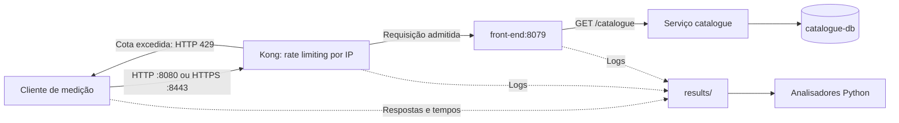

# Como a aplicação funciona

Mapa baseado na inspeção do código e das configurações locais em 20/10/2026. Os resultados experimentais citados são os registrados em 16/10; nenhum serviço foi iniciado para escrever este guia.

## As três partes do projeto

1. **Sock Shop:** aplicação de demonstração de uma loja de meias, distribuída em serviços. Os manifests usam imagens prontas `weaveworksdemos/*`; o código interno desses serviços não está neste repositório.
2. **Gateway:** recebe as requisições, aplica a política de limitação e encaminha as admitidas. Kong, NGINX e Envoy são alternativas; OpenResty/Lua pertence a outro setup.
3. **Instrumentação:** scripts produzem requisições, coletam respostas e logs e calculam resultados. Essa é boa parte do código próprio do laboratório.

O objetivo recente é verificar se as decisões do limitador respeitam a política, especialmente com requisições concorrentes em HTTP/2. Gerar muitas requisições é um meio de observação; a conclusão depende da correlação das evidências.

## Caminho de uma requisição na trilha Kong

No [Compose do Kong](../../gateways/kong/docker-compose.override.yml), a porta 8080 do host aponta para a 8000 do container; a 8443 recebe TLS/HTTP2. O [kong.yml](../../gateways/kong/kong.yml) define o upstream `http://front-end:8079` e o plugin `rate-limiting` com `minute: 100`, `policy: local` e `limit_by: ip`.

Para estudar `GET /catalogue`, acompanhe a resposta do cliente, o registro no gateway e o recebimento no frontend. No piloto, respostas 200 também foram verificadas como catálogo JSON válido. Uma resposta 500 ou uma falha de transporte exige diagnóstico próprio.

A rota `/healthz` do Kong produz uma resposta sintética por plugin. Ela ajuda a verificar o gateway, mas não comprova que catálogo e banco funcionam. HTTP/2 entre cliente e gateway também não comprova HTTP/2 entre gateway e serviços.

## Duas formas de montar o ambiente

| Aspecto | Gateways intercambiáveis | Setup original |
|---|---|---|
| Arquivos | `gateways/base/docker-compose.yml` + override escolhido | `original_experiment/setup/docker-compose.yml` |
| Gateway | Kong, NGINX ou Envoy | OpenResty com NGINX e Lua |
| Entrada | `start.sh`, com `API_GATEWAY`; padrão NGINX | Docker Compose em `original_experiment/setup/` |
| Saúde | `/healthz` | `/health` |
| Política | Depende do gateway escolhido | Contadores por chave, IP e usuário quando informado |
| Foco de estudo | Piloto Kong e comparação de políticas | Algoritmos 1–5 e origem do laboratório |

As alternativas usam portas 8080/8443 e nomes de containers em comum. Escolha uma composição por vez. No setup local examinado, não há serviço Apache separado: o próprio OpenResty recebe TLS e faz proxy. `original_experiment/setup/gateway/application.yml` é uma referência; o [Dockerfile](../../original_experiment/setup/gateway/Dockerfile) mostra o que é construído de fato.

## Ordem de leitura do código

Todos os caminhos abaixo são relativos a `lab/`.

| Ordem | Arquivo | O que procurar |
|---|---|---|
| 1 | [Compose base](../../gateways/base/docker-compose.yml) | Serviços, imagens, dependências e rede |
| 2 | [Override Kong](../../gateways/kong/docker-compose.override.yml) | Portas, volumes, imagem e configuração montada |
| 3 | [Política Kong](../../gateways/kong/kong.yml) | Rota, upstream, identidade e limite |
| 4 | [Inicialização](../../start.sh) e [parada](../../stop.sh) | Escolha do gateway e composição dos manifests |
| 5 | [Piloto HTTP/1.1](../../tests/pilot_kong_http1.py) | `main()`, nova janela, identidade fixa, IDs, coleta |
| 6 | [Análise do piloto](../../tests/analyze_pilot_kong_http1.py) | `analyze()`, verificações e cálculo condicionado à validade |
| 7 | [Gerador diagnóstico HTTP/2](../../diagnostics/http2_bounded.go) | Concorrência, conexão, protocolo, tempos e limites da execução |
| 8 | [Orquestrador](../../diagnostics/run_bounded.py) e [analisador HTTP/2](../../diagnostics/analyze_bounded.py) | Etapas, frames, recursos e correlação de logs |
| 9 | [Testes de contrato](../../tests/test_rate_limiting.py) e [fixtures](../../tests/conftest.py) | O que a suíte verifica e seu ciclo de containers |
| 10 | [NGINX](../../gateways/nginx/nginx.conf), [Envoy](../../gateways/envoy/envoy.yaml), [Lua](../../original_experiment/setup/gateway/ratelimit.lua) | Diferenças de política e identidade |

A suíte de contrato inicia e encerra containers e contém remoção de volumes no teardown. Para estudar, leia primeiro o código e os relatórios existentes. Aprovar essa suíte não comprova precisão concorrente nem equivalência matemática entre as políticas.

## A trilha anterior de algoritmos (consulta opcional)

Todo esse fluxo está isolado em [original_experiment/](../../original_experiment/README.md). O estudo atual não depende dele.

[Descoberta](../../original_experiment/algorithms/algorithm1_discover.py) → `original_experiment/results/endpoints.json` → [seleção por sondagens](../../original_experiment/algorithms/algorithm2_identify.py) → `original_experiment/results/targets.json` → [geradores](../../original_experiment/attacks) → [monitoramento](../../original_experiment/monitoring).

O algoritmo 1 busca rotas em OpenAPI e no cliente. O 2 usa latência e status como heurística de seleção, sem medir diretamente o custo de CPU de cada endpoint. Os algoritmos 3 e 4 geram tráfego HTTP/1.1; o 5 usa HTTP/2. Os geradores antigos variam identidades e não substituem o piloto controlado por IP fixo.

[attack_cli.py](../../original_experiment/attack_cli.py) e [run_lab.sh](../../original_experiment/run_lab.sh) ainda selecionam o algoritmo 5 original. Há uma [versão corrigida](../../original_experiment/attacks/algorithm5_http2_mux_fixed.go) independente. A instrumentação recente de conexões e frames fica em `diagnostics/`, separada dessas duas versões.

## Conceitos para interpretar os resultados

| Conceito | Significado neste estudo |
|---|---|
| Endpoint | Combinação de método e caminho, como `GET /catalogue` |
| Identidade | Chave usada para contar a cota; no piloto Kong, IP efetivo |
| Janela fixa | Contagem dentro de um intervalo delimitado; a inspeção do Kong instalado registrou alinhamento ao minuto |
| Concorrência | Requisições com execução sobreposta |
| Multiplexação | Streams HTTP/2 compartilhando uma conexão; confirmar no protocolo, não apenas nas flags |
| Spillover | Admissões além do permitido pela referência adotada |
| Falso positivo | Bloqueio de uma requisição que deveria ser admitida |
| Oráculo | Regra usada para decidir qual seria a resposta esperada do limitador |

No piloto sequencial válido, a referência é admitir as primeiras 100 e bloquear as dez seguintes. O denominador das métricas desse piloto é 100. Para concorrência e comparação com outras políticas, o protocolo ainda precisa formalizar a referência e os denominadores.

O NGINX configurado com `100r/m` e `burst=100 nodelay` não representa a mesma regra da janela fixa do Kong. Comparar os dois exige considerar o comportamento temporal de cada política.

## O que os registros permitem concluir

O relatório HTTP/1.1 registra 100 admissões e dez bloqueios. O diagnóstico HTTP/2 registra 100, 112 e 128 admissões nas condições avaliadas, com volumes e pausas diferentes. Há evidência de excesso nas condições concorrentes observadas, mas uma rodada por condição não estabelece repetibilidade nem causalidade exclusiva de HTTP/2. Não foi demonstrada saturação de CPU.

Leia o [estado consolidado](../status/CURRENT_STATUS.md) para detalhes e o [protocolo](../methodology/EXPERIMENTAL_PROTOCOL.md) para as pendências metodológicas.
